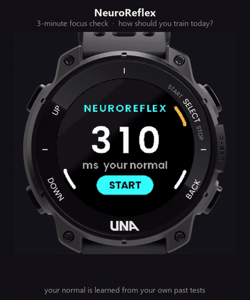

# NeuroReflex

A 3-minute focus check for the [UNA Watch](https://unawatch.com) that tells you how to train today.
Entry for the UNA App Development Competition, October 2026.



It runs the **PVT-B**, the 3-minute Psychomotor Vigilance Task used in sleep and fatigue
research (Basner & Dinges, 2011). The screen turns green at random moments and you tap as fast as you can.

- **Your normal, not an average.** The first 3 tests learn your personal reaction time
  (median of your last 7 tests). After that every test is judged against it.
- **A decision, not a number.**
  - **PRIMED**: 4% or more faster than your normal with few lapses. Go hard today.
  - **NORMAL**: train as planned.
  - **DRAINED**: 10% or more slower, or 20%+ of taps were lapses (500 ms or more). Easy day or rest.
- **Trend.** Your last 14 tests, one bar each, coloured by that day's call.
- **Details.** Median, every tap, lapses and early presses.

| Button | Action |
|---|---|
| R1 | start / again |
| any of L1, L2, R1 | tap on green |
| L2 / L1 on the result | next / previous page |
| R2 | cancel a test, or exit |

Uses no sensors: buttons, screen, vibration, buzzer, and the watch's storage for history (`history.bin`).
The thresholds are estimates of normal day-to-day variation, not clinically validated.

## How it works

| Path | What |
|---|---|
| `Software/Libs/Sources/PvtEngine.cpp` | PVT-B trial engine and scoring; pure C++ |
| `Software/Libs/Sources/Readiness.cpp` | personal baseline and the PRIMED / NORMAL / DRAINED call |
| `Software/Libs/Sources/Presenter.cpp` | screen logic: buttons in, a drawable frame out |
| `Software/Libs/Sources/Service.cpp` | service process: haptics, buzzer, saves and loads the history |
| `Software/Apps/LVGL-GUI/` | LVGL GUI process |
| `Software/Apps/LVGL-GUI/simulator/WatchHost.cpp` | PC simulator window showing the display inside the watch |

## Build

Needs the [UNA SDK](https://github.com/UNAWatch/una-sdk) with `UNA_SDK` pointing at it (forward slashes).

```powershell
# watch image (.uapp), with the SDK's ARM toolchain on PATH
cmake -S Software/Apps/NeuroReflex-CMake -B Software/Apps/NeuroReflex-CMake/build -G Ninja
cmake --build Software/Apps/NeuroReflex-CMake/build

# host tests
cmake -S Tests/Host -B Tests/Host/build
cmake --build Tests/Host/build --config Debug
Tests/Host/build/Debug/neuroreflex-host-tests.exe

# PC simulator (32-bit, uses the SDL2 TouchGFX ships)
python Tests/Sim/watch/fetch_watch.py          # optional: the watch frame around the display
cmake -S Software/Apps/LVGL-GUI/simulator -B Software/Apps/LVGL-GUI/simulator/build -A Win32
cmake --build Software/Apps/LVGL-GUI/simulator/build --config Debug
```

Simulator keys: `1` L1, `2` L2, `3` R1, `4` R2, `Esc` quit. `Tests/Sim/drive.ps1 -Full` runs a whole
session; `Tests/Sim/look.ps1` captures every screen with a seeded history.

`Output/` holds the released build (`NeuroReflex_1.0.0.uapp`, store ID `CF435D255DF26B52`).

## Licence

MIT, see [LICENSE](LICENSE). Poppins is under the SIL Open Font License. The watch photo in the
previews and simulator belongs to UNA Watch Ltd.
